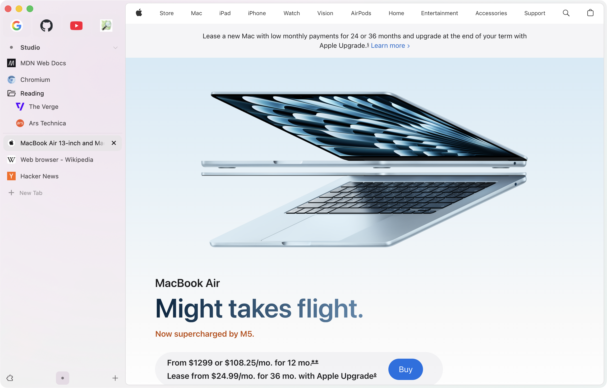
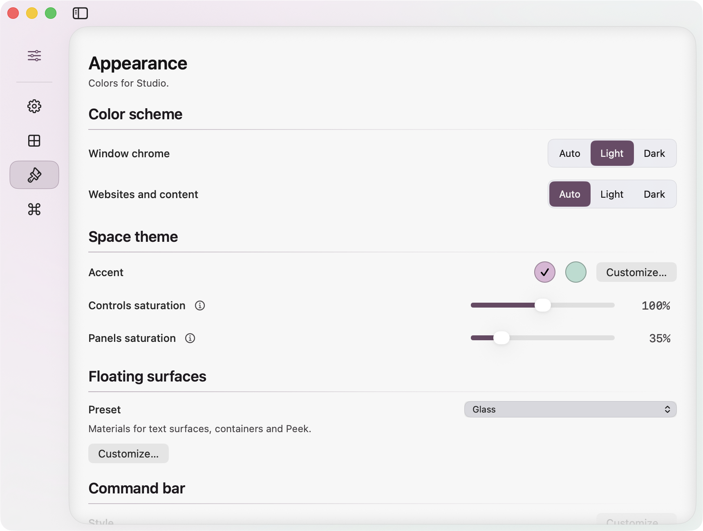
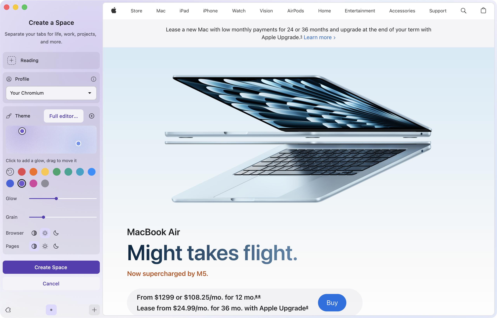
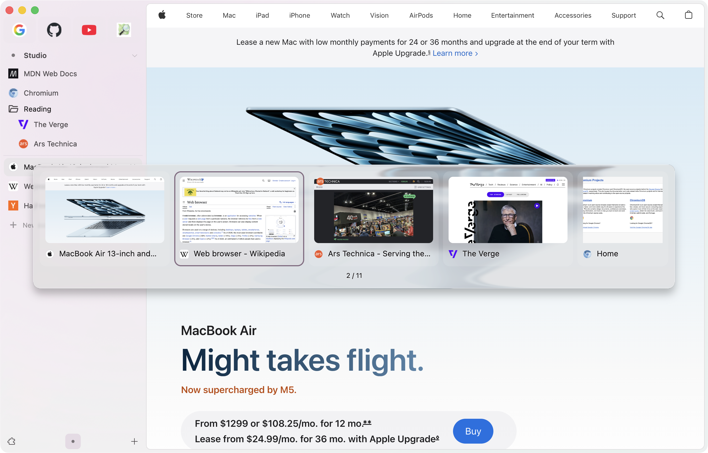
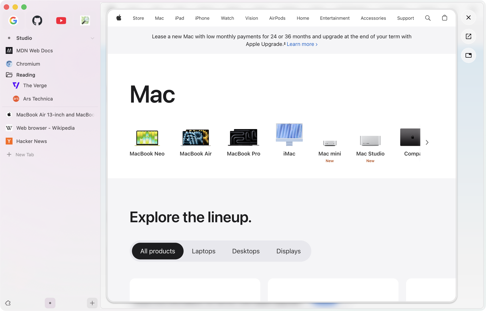

# Arcium

Helium's privacy and speed, with an Arc-inspired workspace you can make your own.

Arcium brings Spaces, Pins, Favorites, Peek, and Little Arc to [Helium](https://helium.computer/), with native macOS settings and more ways to shape the browser's colors and layout. This is an early preview, with the source included.



Screenshots show the October 22 development build with the newer glass styling. The download below is the October 17 preview.

[Download the macOS preview](../../releases) · [Release notes](docs/preview-release.md) · [Build from source](docs/building.md)

## Quickstart

Apple Silicon · macOS 26 or later · No build tools needed

1. Download the DMG from [Releases](../../releases).
2. Open **Install Arcium** and click **Install**.
3. Finish the first-run setup, then press **⌘,** to make it yours.

New profiles start with a pastel vertical sidebar, navigation above the tabs, Peek, and recent-tab cycling. Existing profiles keep their settings.

The first preview uses the October 17 build and Chromium 151. It needs a Chromium security update before it can be an up-to-date everyday browser. Automatic updates are not configured yet. See the [release notes](docs/preview-release.md) for signing status and known limits.

## Roadmap

- **Pinned split views.** Keep a pair of pages together as a saved sidebar item.
- **A better alternative to auto-archiving.** Explore a Shelf-inspired way to put tabs aside and find them again.
- **Little Arc + Peek.** Bring quick external links and in-browser previews into one interaction.
- **Local AI for tab cleanup.** Use a local model to help sort an overcrowded workspace.
- **Built-in browser control for agents.** Give agents an efficient way to operate the browser.

These are planned directions, not features in the download. Chromium updates and release reliability come first.

## Arc aesthetics, more customization

Put navigation in the sidebar, choose your layout and collapse behavior, and tune colors, glass, grain, borders, and UI scale. Native Settings gives you direct control over the browser's appearance.



## Pins and Favorites

Favorites follow you across Spaces. Pins and folders belong to a Space. A Pin remembers its home page even after you follow links, and closing its live tab leaves the saved item in place.

## Spaces

Separate work, reading, and everything else into Spaces with their own Pins and styling. Spaces live inside browser profiles; Spaces in the same profile share cookies and sign-ins. Use separate profiles for separate accounts.



## Recently used tabs

Hold **Control** and press **Tab** to preview recent tabs. New installations enable recent-use cycling. The Keyboard Shortcuts settings also offers explicit Recent Tab actions and an Arc-inspired preset.



## Peek

Open eligible links in a preview while keeping the saved page underneath. You can also choose Peek from a link's context menu.



## Little Arc, for now

Open a link from another app in a small browser window. The current implementation handles one eligible HTTP or HTTPS link at a time. A shortcut for opening an empty Little Arc search window is not implemented yet.


## The Helium foundation

Arcium keeps Helium's ad and tracker blocking, Chromium extension support, and split views. The work here focuses on the workspace around your pages.

## Bring your Arc sidebar

Quit Arc, then open Arcium's Settings → General → More settings… → Import data. Choose Arc and enable **Import sidebar as Pins** to bring over Spaces, Favorites, Pins, and folders.

Back up your browser data first. Repeating an import replaces that source's imported Space trees, including edits you've made inside them.

[Import guide](docs/arc-quickstart.md) · [Passwords and migration](docs/arc-daily-driver-migration.md)

## Source

This repository includes the shared core in `helium-chromium/`, plus macOS integration and packaging. There are no private submodules. See the [build guide](docs/building.md) for dependencies and disk requirements.

```sh
git clone https://github.com/dr-baker/Arcium-browser.git
cd Arcium-browser
./build.sh arm64
```

Arcium is an independent project, not affiliated with The Browser Company. It descends from [Helium for macOS](https://github.com/imputnet/helium-macos) and [ungoogled-chromium-macos](https://github.com/ungoogled-software/ungoogled-chromium-macos). Original Arcium additions are [GPL-3.0](LICENSE); imported code keeps its original licenses.
